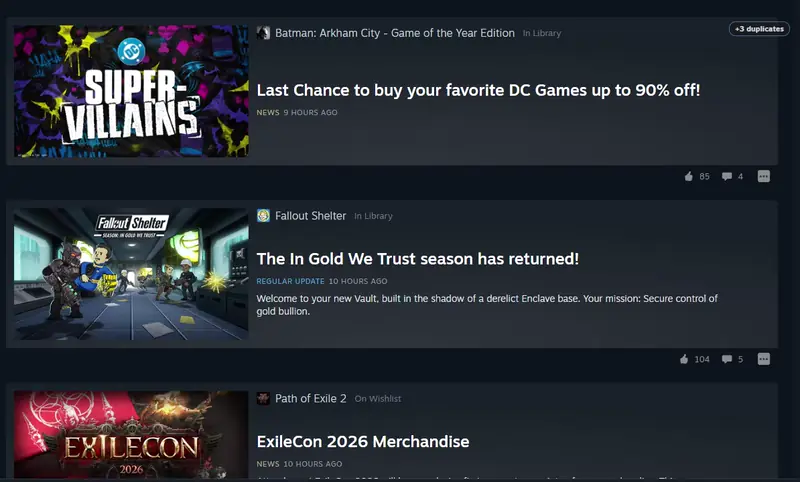

# Steam News Dedupe

Stop seeing the same sale announcement ten times.

Publishers often post one identical announcement for **every game in a franchise**, such as
"WB Games Autumn Sale is here" on every WB title you own or "Fallout Day Celebrations" on both Fallout 4 and Fallout 76.
Your Steam News feed then fills up with copies of what is basically one ad.

**Steam News Dedupe** keeps the first copy of each post in the Steam News Hub and hides the rest.



## Features

- **One post instead of many.** Duplicate announcements across different games collapse into a single entry.
- **Nothing is lost.** The post that stays shows a small **+N duplicates** badge. Hover it to see which other games got the same post, or click it to show or hide the copies.
- **Careful matching.** Posts are merged when they share a title **and** either have the same text (store links and images are ignored) or were posted within 3 days of each other. Generic titles like "Patch Notes" only merge when the text matches too.
- **Works as you scroll.** Posts loaded by infinite scroll are checked as they appear.
- **No network calls outside Steam.** The plugin only re-reads the event data the News Hub already loads from `store.steampowered.com`.

## Settings

Open **Millennium → Plugins → Steam News Dedupe**:

| Setting | Default | Description |
|---|---|---|
| Hide duplicate news posts | On | Master switch. |
| Aggressive matching (title only) | Off | Merge *any* posts with the same title, even if the text differs. |
| Show "+N duplicates" badge | On | Show the badge on the post that's kept. |

Changes apply right away. If they don't, reload the News page.

## Where it works

- The Steam **News Hub** (Store → News, `store.steampowered.com/news`) in the Steam client.

The **What's New** shelf on the Library home page isn't covered yet.

## Building from source

Requires [Millennium](https://steambrew.app) ≥ 3.4 and [Bun](https://bun.com) or Node.js.

```bash
bun install        # or: npm install
bun run build      # or: npx starlight pack
```

The build installs the plugin into your local Millennium (`output_path = "auto"` in `millennium.toml`).
Then enable it under Millennium → Plugins.

### Project layout

| Path | Purpose |
|---|---|
| `webview/preload.ts` | Injected into Steam's web views. It only runs on `store.steampowered.com/news/*`. |
| `webview/dedupe.ts` | Reads the hub's event data (via the Performance API, without patching `fetch`/XHR), groups matching posts, and hides the duplicate cards. |
| `frontend/index.tsx` | Settings panel. Settings are stored with Millennium's plugin config and shared with the webview script. |
| `shared/settings.ts` | Setting keys and defaults. |

To debug, open the News Hub devtools console and inspect `window.__newsDedupe`.

## License

[MIT](LICENSE)
